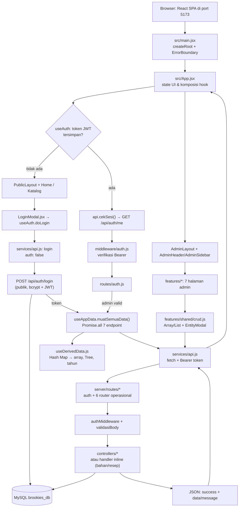
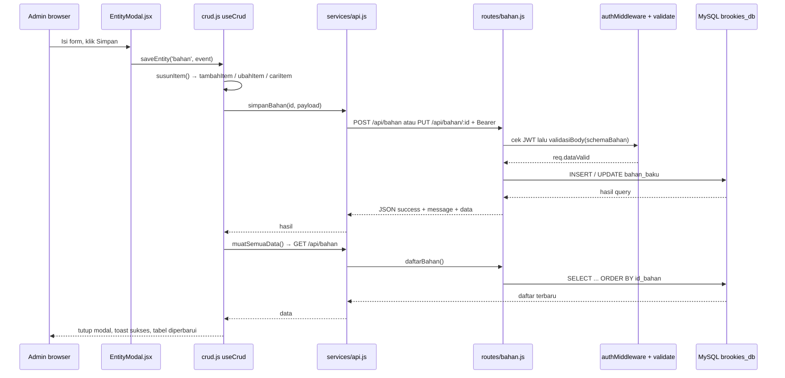

# Peta Source Code — Website Manajemen Usaha Brookies

Dibuat pada **Tahap 15C**. Seluruh isi merujuk pada kode yang ada setelah Tahap 15A,
Tahap 15B, dan addendum 15B. Dokumen ini hanya menjelaskan — tidak mengubah kode.

Dokumen terkait:

- [`DOKUMENTASI_PERUBAHAN.md`](./DOKUMENTASI_PERUBAHAN.md) — riwayat perubahan & daftar endpoint.
- [`DOKUMENTASI_STRUKTUR_DATA.md`](./DOKUMENTASI_STRUKTUR_DATA.md) — panduan empat struktur data.

---

## A. Gambaran Umum

### Tujuan aplikasi

Brookies adalah aplikasi manajemen usaha cookies. Sisi publik menampilkan beranda dan
katalog produk. Sisi admin mengelola:

| Area | Data yang dikelola |
| --- | --- |
| Dashboard | Ringkasan pendapatan, pengeluaran, produksi, stok menipis, transaksi terbaru |
| Transaksi | Penjualan per saluran & status |
| Pengeluaran | Pembelian bahan baku dan biaya operasional |
| Bahan Baku | Stok, satuan, batas minimum, kebutuhan bulanan, harga |
| Data Resep | Komposisi tiap produk dan hasil per batch |
| Produksi | Batch produksi + salinan komposisi (snapshot) |
| Laporan Keuntungan | Hierarki Tahun → Bulan → Hari |

Sumber data permanen adalah **MySQL**. `localStorage` hanya dipakai untuk token JWT.

### Teknologi

| Lapisan | Teknologi | Bukti di kode |
| --- | --- | --- |
| Frontend | React 19, Vite 8, Tailwind CSS 4 | `package.json`, `vite.config.js` |
| UI | `lucide-react` (ikon), `motion/react` (animasi), `recharts` (grafik) | import di `src/features/*` |
| Font | DM Sans (teks) + Playfair Display (judul/brand) | `src/index.css:1`, `:41–42` |
| Backend | Node.js (ESM), Express 5, CORS, `express.json` | `server/server.js:8–9,45–56` |
| Autentikasi | JWT (`jsonwebtoken`) + `bcrypt` | `server/middleware/auth.js`, `server/routes/auth.js` |
| Validasi | Validator lokal (`teks`, `angka`, `tanggal`, `pilihan`, `opsional`) | `server/middleware/validate.js` |
| Database | MySQL/MariaDB via `mysql2/promise`, connection pool | `server/config/database.js:13–25` |
| Konfigurasi | `dotenv` dibaca **satu kali** di `server/config/env.js:18` | `server/config/env.js` |
| Lint | `oxlint` | `npm run lint` |

### Arsitektur hubungan

```text
Browser (React SPA, port 5173)
        │  fetch + Authorization: Bearer <token>
        ▼
Backend Express (port 3000)
        │  router → middleware → controller → query SQL
        ▼
MySQL (brookies_db)

Frontend TIDAK menulis langsung ke database.
Semua mutasi lewat REST API; setelah mutasi, frontend memuat ulang data dari API.
```

Untuk pengujian mutasi dipakai pasangan `PORT=3100` + `DB_NAME=brookies_db_test`.
Karena `dotenv` tidak menimpa variabel yang sudah ada di `process.env`, override
lewat environment variable berjalan tanpa mengubah `.env`.

---

## B. Struktur Folder

### Frontend — `src/`

```text
src/
├── main.jsx                 Entry point: createRoot + StrictMode + ErrorBoundary
├── App.jsx                  Komponen akar: state UI, routing halaman, komposisi hook
├── App.css                  Gaya lama untuk kartu produk (ProductGrid)
├── index.css                Design token Tahap 15A + base style Tailwind
│
├── algorithms/              Algoritma murni, tanpa state React
│   └── bubbleSort.js
├── assets/                  Kosong (gambar ada di public/images/)
├── components/              UI umum yang tidak tahu tentang data usaha
│   └── common/              Button, Empty, ErrorBoundary, Field, Input, Modal,
│                            PageTitle, ProductGrid, Select, Stat, Table, Toast
├── constants/               Nilai tetap aplikasi
│   └── app.js               status, saluran, kategori, tahun, pesan 401, dataAwal
├── data/                    Data master statis
│   └── master.js            dataMenu (produk & harga), data lama yang dipertahankan
├── features/                Per halaman/admin + logika yang melekat padanya
│   ├── auth/                useAuth.js, LoginModal.jsx
│   ├── bahan-baku/          BahanBaku.jsx
│   ├── dashboard/           Dashboard.jsx
│   ├── laporan/             Laporan.jsx
│   ├── pengeluaran/         Pengeluaran.jsx
│   ├── produksi/            Produksi.jsx
│   ├── resep/               Resep.jsx
│   ├── transaksi/           Transaksi.jsx
│   └── shared/              crud.js, EntityModal.jsx, tableHelpers.jsx
├── hooks/                   Logika reusable dengan state React
│   ├── useAppData.js        Loader 7 endpoint + pembentukan Hash Map
│   └── useDerivedData.js    Hash Map → array, Tree laporan, daftar tahun
├── layouts/                 Kerangka halaman
│   ├── AdminLayout.jsx      + AdminHeader.jsx, AdminSidebar.jsx
│   └── PublicLayout.jsx     + PublicHeader.jsx, PublicFooter.jsx
├── lib/                     Utilitas kecil
│   └── utils.js             cn, rupiah, tanggalID
├── pages/                   Halaman publik
│   └── Home.jsx, Katalog.jsx
├── services/                Satu pintu komunikasi API
│   ├── api.js               Semua fetch, token, envelope, 401
│   └── storage.js           Simpan/baca/hapus token JWT saja
└── structures/              Implementasi struktur data
    ├── arrayList.js         Array / List (4 operasi immutable)
    ├── hashMap.js           Pembungkus Map native untuk bahan baku
    └── tree.js              NodeLaporan + bangunTreeLaporan
```

| Folder | Fungsi | Jenis file | Tanggung jawab & hubungan |
| --- | --- | --- | --- |
| `components/common/` | UI presentasional | `.jsx` | Dipakai semua halaman. Tidak mengimpor `features/` atau `hooks/`, sehingga tidak ada siklus. |
| `features/<halaman>/` | Tampilan per menu admin | `.jsx` | Menerima props dari `App.jsx`; memanggil `bubbleSort`, `utils`, dan komponen umum. |
| `features/shared/` | Modal form & orkestrasi CRUD | `.js`/`.jsx` | `crud.js` memakai `structures/arrayList.js` dan `services/api.js`. `EntityModal.jsx` memakai Hash Map lewat props. |
| `hooks/` | State & efek aplikasi | `.js` | `useAppData` → `api` + `hashMap`; `useDerivedData` → `tree`. Hasilnya dikonsumsi `App.jsx`. |
| `services/` | Transport data | `.js` | `api.js` → `storage.js`. Tidak pernah mengimpor hook; 401 dikirim lewat callback `aturPenangan401`. |
| `structures/` | Algoritma/struktur murni | `.js` | Tidak mengimpor apa pun. Dipanggil hooks/features. |
| `algorithms/` | Pengurutan tabel | `.js` | Tidak mengimpor apa pun. Dipanggil 4 halaman. |
| `layouts/` | Kerangka visual | `.jsx` | `AdminLayout` mengimpor header/sidebar; `PublicLayout` mengimpor header/footer. |
| `pages/` | Konten publik | `.jsx` | Memakai `data/master.js` + `ProductGrid`. |
| `constants/`, `data/`, `lib/` | Nilai & pembantu | `.js` | Modul leaf; diimpor banyak tempat, tidak mengimpor fitur. |

### Backend — `server/`

```text
server/
├── server.js                Entry point Express + middleware global + mount router
├── seedAdmin.js             Script seed akun admin (bcrypt)
├── config/
│   ├── env.js               Satu-satunya dotenv.config(); objek config + validasi
│   └── database.js          mysql.createPool + helper cek/tutup + default export db
├── controllers/
│   ├── transaksiController.js
│   ├── pengeluaranController.js  + penyesuaian stok dalam transaksi DB
│   ├── produksiController.js     + snapshot & pengembalian stok
│   └── laporanController.js      + peta Map native untuk grafik 12 bulan
├── middleware/
│   ├── auth.js              Verifikasi Bearer JWT → req.admin
│   ├── validate.js          teks/angka/tanggal/pilihan/opsional/validasiBody
│   └── errorHandler.js      404 + terjemahan kode MySQL → HTTP status
├── migrations/
│   ├── 001_tambah_kolom_produk.js
│   └── 002_snapshot_resep_produksi.js
├── routes/
│   ├── auth.js              POST /login (publik), GET /me (JWT)
│   ├── bahan.js             CRUD bahan (JWT, query inline)
│   ├── resep.js             CRUD resep (JWT, query inline)
│   ├── transaksi.js         CRUD transaksi (JWT → controller)
│   ├── pengeluaran.js       CRUD pengeluaran (JWT → controller)
│   ├── produksi.js          CRUD produksi (JWT → controller)
│   └── laporan.js           GET /dashboard & /keuntungan (JWT → controller)
└── utils/
    └── apiError.js          ApiError + helper + asyncHandler
```

| Folder | Fungsi | Jenis file | Tanggung jawab & hubungan |
| --- | --- | --- | --- |
| `config/` | Konfigurasi & koneksi | `.js` | `env.js` dibaca semua modul; `database.js` dipakai routes & controllers. |
| `routes/` | Definisi endpoint & validasi | `.js` | Di-mount `server.js`. Memasang `authMiddleware` + `validasiBody`, lalu memanggil controller (atau query inline untuk bahan/resep). |
| `controllers/` | Logika bisnis & transaksi DB | `.js` | Mengimpor `database.js` dan `utils/apiError.js`. Tidak mengimpor routes. |
| `middleware/` | Penjaga request & error | `.js` | `auth.js` → JWT; `validate.js` → `req.dataValid`; `errorHandler.js` → response seragam. |
| `migrations/` | Perubahan skema idempoten | `.js` | Dijalankan manual/`npm run migrate`, bukan saat server start. |
| `utils/` | Pembantu error | `.js` | Dipakai routes, controllers, middleware. |

File root penting: `index.html` (mount `#root` + `/src/main.jsx`), `vite.config.js`
(alias `@` → `src/`), `jsconfig.json` (alias `@/*` untuk editor), `.env.example`
(template variabel), `.gitignore` (mengabaikan `.env`).

---

## C. Peta File Penting

| File | Lokasi | Fungsi | Kapan dibuka |
| --- | --- | --- | --- |
| `main.jsx` | `src/` | Entry point React; pasang `ErrorBoundary` & `index.css` | Saat menelusuri dari HTML ke aplikasi |
| `App.jsx` | `src/` | State halaman/notifikasi/search/filter; menggabungkan hook, layout, halaman | Saat memahami komposisi aplikasi atau routing internal |
| `index.css` | `src/` | Design token 15A, font, alias `--surface`/`--footer` | Saat mengubah warna/font/tipografi |
| `App.css` | `src/` | Gaya lama kartu produk | Saat mengubah tampilan `ProductGrid` |
| `AdminLayout.jsx` | `src/layouts/` | Kerangka admin + slot `content` | Saat mengubah struktur halaman admin |
| `AdminHeader.jsx` / `AdminSidebar.jsx` | `src/layouts/` | Header & menu 7 halaman | Saat menambah/menu navigasi |
| `PublicLayout.jsx` | `src/layouts/` | Kerangka beranda & katalog | Saat mengubah header/footer publik |
| `PageTitle.jsx`, `Table.jsx`, `Modal.jsx`, `Toast.jsx`, … | `src/components/common/` | Komponen UI tanpa logika bisnis | Saat mengubah tampilan bersama |
| `BahanBaku.jsx`, `Transaksi.jsx`, `Pengeluaran.jsx`, `Resep.jsx`, `Produksi.jsx`, `Laporan.jsx`, `Dashboard.jsx` | `src/features/*/` | Tabel, filter, dan tombol aksi per halaman | Saat mengubah tampilan atau urutan tabel |
| `useAuth.js` | `src/features/auth/` | Cek sesi, login, logout, penanganan 401 | Saat mempelajari alur login |
| `LoginModal.jsx` | `src/features/auth/` | Form login admin | Saat mengubah form/login |
| `crud.js` | `src/features/shared/` | `useCrud`: `startAdd/startEdit/saveEntity/delEntity`, Array/List, validasi frontend | Saat menambah/mengubah/hapus entitas |
| `EntityModal.jsx` | `src/features/shared/` | Satu form dinamis untuk 5 jenis data | Saat mengubah field form |
| `tableHelpers.jsx` | `src/features/shared/` | Tombol Edit/Hapus + kartu tabel | Saat mengubah aksi baris tabel |
| `useAppData.js` | `src/hooks/` | `Promise.all` 7 endpoint, Hash Map bahan, muat ulang data | Saat mempelajari dari mana data berasal |
| `useDerivedData.js` | `src/hooks/` | Hash Map → array, Tree laporan, daftar tahun | Saat mempelajari data turunan |
| `api.js` | `src/services/` | Satu tempat `fetch`, token, envelope, error 401 | Saat menambah endpoint atau mengubah URL backend |
| `storage.js` | `src/services/` | Token JWT di `localStorage` (`brookies_token`) | Saat mengubah sesi login |
| `app.js` | `src/constants/` | `status`, `saluran`, `kategoriPengeluaran`, pesan 401, `dataAwal` | Saat menambah opsi pilihan |
| `master.js` | `src/data/` | `dataMenu` (nama & harga produk) | Saat menambah produk katalog |
| `utils.js` | `src/lib/` | `rupiah`, `tanggalID`, `cn` | Saat mengubah format tampilan |
| `bubbleSort.js` | `src/algorithms/` | Pengurutan salinan array | Saat mengubah urutan tabel |
| `arrayList.js` | `src/structures/` | 4 operasi Array/List immutable | Saat mempelajari CRUD sisi frontend |
| `hashMap.js` | `src/structures/` | `Map` native untuk lookup bahan | Saat mempelajari pencarian bahan by ID |
| `tree.js` | `src/structures/` | `NodeLaporan` + `bangunTreeLaporan` | Saat mempelajari laporan hierarkis |
| `server.js` | `server/` | CORS, JSON, health check, mount router, 404, error handler, shutdown | Saat menambah router atau middleware global |
| `routes/auth.js` | `server/routes/` | `POST /api/auth/login`, `GET /api/auth/me` | Saat mengubah login/JWT |
| `routes/bahan.js`, `routes/resep.js` | `server/routes/` | Endpoint + query SQL inline | Saat mengubah CRUD bahan/resep |
| `routes/transaksi.js`, `routes/pengeluaran.js`, `routes/produksi.js` | `server/routes/` | Endpoint + validasi → controller | Saat menambah field payload |
| `routes/laporan.js` | `server/routes/` | `/dashboard` & `/keuntungan` | Saat mengubah endpoint laporan |
| `laporanController.js` | `server/controllers/` | Query dashboard & laporan; `Map` untuk 12 bulan | Saat mengubah grafik/ringkasan |
| `pengeluaranController.js` | `server/controllers/` | Transaksi DB + penyesuaian stok | Saat mengubah perhitungan stok pembelian |
| `produksiController.js` | `server/controllers/` | Resep terkunci, snapshot, potong/kembalikan stok | Saat mengubah produksi/snapshot |
| `transaksiController.js` | `server/controllers/` | CRUD transaksi + filter + map DECIMAL | Saat mengubah daftar transaksi |
| `auth.js` | `server/middleware/` | Verifikasi `Bearer <token>` | Saat mengubah otorisasi |
| `validate.js` | `server/middleware/` | Skema validasi `req.dataValid` | Saat menambah aturan input |
| `errorHandler.js` | `server/middleware/` | 404 + terjemahan error MySQL | Saat mengubah pesan error API |
| `env.js` | `server/config/` | `dotenv.config()` tunggal + objek `config` | Saat menambah variabel lingkungan |
| `database.js` | `server/config/` | Pool `mysql2` + `cekKoneksiDatabase`, `tutupKoneksiDatabase`, `default db` | Saat mengubah koneksi/health check |
| `apiError.js` | `server/utils/` | `ApiError`, `badRequest`, `unauthorized`, `notFound`, `asyncHandler` | Saat menambah jenis error |
| `002_snapshot_resep_produksi.js` | `server/migrations/` | Tabel `produksi_detail` + FK + backfill | Saat mempelajari asal snapshot |

---

## D. Arsitektur dan Alur Aplikasi



### Narasi alur sesuai kode

1. `index.html` memuat `/src/main.jsx`; `main.jsx` merender `<App />` di dalam
   `StrictMode` dan `ErrorBoundary`, lalu mengimpor `index.css`.
2. `App.jsx` menyiapkan state UI, lalu memanggil tiga hook: `useAppData`,
   `useDerivedData`, dan `useCrud`, ditambah `useAuth`.
3. `useAuth` mengecek token di `localStorage`. Bila ada, dipanggil
   `GET /api/auth/me` (ber-JWT). Bila tidak ada / gagal, pengguna melihat
   halaman publik dan `LoginModal`.
4. Login mengirim `POST /api/auth/login` **tanpa token**; backend memverifikasi
   `bcrypt`, menandatangani JWT, lalu `api.js` menyimpan token dan
   `useAuth` memuat data.
5. `muatSemuaData()` menjalankan **tujuh request sekaligus**: `daftarBahan`,
   `daftarResep`, `daftarTransaksi`, `daftarPengeluaran`, `daftarProduksi`,
   `dashboard`, dan `laporan` (`useAppData.js:20–24`).
6. `useDerivedData` mengubah Hash Map menjadi array `allBahan`, membangun Tree
   laporan, dan menyusun `daftarTahun`.
7. `App.jsx` memilih konten salah satu dari tujuh halaman admin; halaman dimuat
   malas (`lazy`) dan dibungkus `Suspense`.
8. Setiap request melewati `services/api.js`, yang menyisipkan header
   `Authorization: Bearer <token>` dan membongkar envelope `{ success, data }`.
9. Di backend, `server.js` sudah memasang CORS & `express.json`. Enam router
   operasional (`bahan`, `resep`, `transaksi`, `pengeluaran`, `produksi`,
   `laporan`) memakai `router.use(authMiddleware)`. Router `auth` hanya
   melindungi `/me`.
10. `validasiBody` menulis `req.dataValid`; controller/route memakai nilai itu,
    bukan `req.body` mentah.
11. Query dijalankan lewat pool `config/database.js`; hasil dikirim sebagai JSON.
12. Setelah mutasi berhasil, `crud.js` memanggil `muatSemuaData()` lagi agar UI
    mengikuti database. 401 dari API memicu `aturPenangan401` → logout UI.

**Endpoint publik:** `GET /api` dan `GET /api/db-check` (keduanya di `server.js`).
Keduanya tidak memakai JWT.

---

## E. Alur CRUD

Contoh berikut memakai **Bahan Baku**. Pola yang sama dipakai transaksi, resep,
pengeluaran, dan produksi lewat `useCrud` yang sama.

### Create / Update



### Read

`useAppData.muatSemuaData()` → `api.daftarBahan()` → `GET /api/bahan` →
`authMiddleware` → handler `routes/bahan.js` →
`SELECT id_bahan AS id, nama_bahan AS nama, ... FROM bahan_baku` →
`buatHashMapBahan()` → `data.dataBahan` → `useDerivedData` → `allBahan` →
tabel `BahanBaku.jsx`.

### Delete

`tableHelpers.jsx` memanggil `delEntity(kind, item.id)` → `crud.js`:
`cariItem` (validasi & guard produksi tanpa snapshot) → `confirm()` →
`api.hapusBahan` → `DELETE /api/bahan/:id` → `hapusItem` pada daftar kerja →
`cariItem` lagi sebagai verifikasi → `muatSemuaData()`.

### Pemetaan lapisan

| Lapisan | File | Peran |
| --- | --- | --- |
| Komponen | `src/features/bahan-baku/BahanBaku.jsx`, `src/features/shared/EntityModal.jsx`, `src/features/shared/tableHelpers.jsx` | Tampilan tabel, form, tombol aksi |
| Pengelola data | `src/features/shared/crud.js` (`useCrud`) | State modal, payload, validasi frontend, Array/List, muat ulang |
| Service | `src/services/api.js` | `simpanBahan`, `hapusBahan`, `daftarBahan`, token JWT |
| Route | `server/routes/bahan.js` | Endpoint + `authMiddleware` + `validasiBody(schemaBahan)` |
| Middleware | `server/middleware/auth.js`, `server/middleware/validate.js` | Otorisasi & `req.dataValid` |
| Controller | **inline di route** `bahan.js` | Query SQL langsung (bahan/resep belum punya controller terpisah) |
| Database | `server/config/database.js` → tabel `bahan_baku` | `INSERT`, `UPDATE`, `DELETE`, `SELECT` |

Catatan penting: untuk **pengeluaran** dan **produksi**, stok tidak diubah di browser.
`crud.js` hanya menyiapkan payload; penyesuaian stok terjadi di controller dalam
satu transaksi MySQL dengan `SELECT ... FOR UPDATE`.

---

## F. Peta Backend

### `server.js` — perakit aplikasi

- Memuat `config` & `validasiConfigServer()` sebelum `listen` (fail-fast bila
  `DB_NAME`/`JWT_SECRET` kosong).
- CORS dengan whitelist `CORS_ORIGIN` (bisa beberapa origin dipisah koma).
- `express.json({ limit: '1mb' })`.
- Dua endpoint publik: `GET /api` dan `GET /api/db-check`.
- Mount tujuh router di bawah `/api/auth`, `/api/bahan`, `/api/resep`,
  `/api/transaksi`, `/api/pengeluaran`, `/api/produksi`, `/api/laporan`.
- Fallback 404 dan `penangananError` dipasang **paling terakhir**.
- Graceful shutdown menutup pool DB.

### Routes — 7 file, 29 endpoint

| Router | Proteksi | Endpoint utama | Handler |
| --- | --- | --- | --- |
| `auth.js` | `POST /login` publik; `GET /me` ber-JWT | login, cek sesi | inline |
| `bahan.js` | `router.use(authMiddleware)` | `GET/POST /`, `PUT/DELETE /:id` | inline + `validasiBody` |
| `resep.js` | `router.use(authMiddleware)` | `GET/POST /`, `PUT/DELETE /:id` | inline + `validasiBody` |
| `transaksi.js` | `router.use(authMiddleware)` | `GET/POST /`, `GET/PUT/DELETE /:id` | `transaksiController` |
| `pengeluaran.js` | `router.use(authMiddleware)` | `GET/POST /`, `GET/PUT/DELETE /:id` | `pengeluaranController` |
| `produksi.js` | `router.use(authMiddleware)` | `GET/POST /`, `GET/PUT/DELETE /:id` | `produksiController` |
| `laporan.js` | `router.use(authMiddleware)` | `GET /dashboard`, `GET /keuntungan` | `laporanController` |

**Enam router operasional yang dilindungi JWT:** `bahan`, `resep`, `transaksi`,
`pengeluaran`, `produksi`, `laporan`. Router `auth` hanya melindungi `/me`.
`/api` dan `/api/db-check` tetap publik.

Route laporan sesuai kode aktual: **`GET /api/laporan/dashboard`** dan
**`GET /api/laporan/keuntungan`**, seperti yang terpasang di `routes/laporan.js`.

### Controllers — 4 file

| File | Tanggung jawab |
| --- | --- |
| `transaksiController.js` | CRUD transaksi, filter tanggal/saluran/status, mapping `DECIMAL` → number, konstanta `SALURAN` & `STATUS_TRANSAKSI` |
| `pengeluaranController.js` | CRUD + `sesuaikanStok()` dengan `FOR UPDATE`; kategori `Bahan Baku` menambah/mengurangi/menyesuaikan stok; total dihitung server |
| `produksiController.js` | `ambilResepProduk()` terkunci, `hitungPemakaian()`, `terapkanStok()`, `simpanDetail()`/`ambilSnapshot()`; stok dikembalikan dari **snapshot lama**, bukan resep terbaru |
| `laporanController.js` | 9 query dashboard + `Map` untuk mengisi 12 bulan, stok menipis, transaksi terbaru; laporan keuntungan untuk `bangunTreeLaporan` frontend |

Semua perubahan stok + catatan berada dalam satu transaksi:
`beginTransaction()` → `COMMIT` / `ROLLBACK` → `release()`.

### Middleware — 3 file

| File | Tanggung jawab |
| --- | --- |
| `auth.js` | Baca `Authorization: Bearer <token>`, `jwt.verify`, cek `payload.id`, set `req.admin`, 401 generik via `unauthorized()` |
| `validate.js` | `teks`, `angka`, `tanggal`, `pilihan`, `opsional`, `validasiBody` → `req.dataValid`; error dikumpulkan per field |
| `errorHandler.js` | `routeTidakDitemukan` (404) + terjemahan kode MySQL (`ER_DUP_ENTRY` → 409, FK → 400/409, koneksi → 503) + response `{ success:false, message }` |

### Konfigurasi & database

- `config/env.js` — **satu-satunya** `dotenv.config()`, path `.env` di root proyek;
  objek `config` berisi `port`, `database`, `jwt`, `corsOrigin`, `admin`;
  `validasiConfigServer()` dan `validasiConfigAdmin()` untuk fail-fast.
- `config/database.js` — `mysql.createPool` dengan `waitForConnections`,
  `connectionLimit`, `dateStrings: true`.
  - **Default export `db`** dipakai seluruh route/controller untuk query.
  - **Named export `cekKoneksiDatabase()`** dipakai saat startup dan oleh
    `/api/db-check`.
  - **Named export `tutupKoneksiDatabase()`** dipakai graceful shutdown.
- `utils/apiError.js` — `ApiError`, `badRequest`, `unauthorized`, `notFound`,
  `asyncHandler`. Helper `forbidden()` dan `conflict()` tersedia tetapi belum
  dipanggil (dokumentasi 15B tidak menghapusnya tanpa bukti pemakaian).
- `migrations/001_tambah_kolom_produk.js` — idempoten, dijalankan `npm run migrate`.
- `migrations/002_snapshot_resep_produksi.js` — membuat `produksi_detail`, FK, dan
  backfill; dijalankan manual dan menolak `brookies_db` tanpa
  `IZINKAN_MIGRASI_UTAMA=1`.
- `seedAdmin.js` — `bcrypt.hash(password, 12)` lalu insert akun admin.

Tabel bisnis: `admin`, `bahan_baku`, `resep`, `transaksi`, `pengeluaran`,
`produksi`, `produksi_detail`.

---

## G. Panduan Menemukan Kode

| Kebutuhan | File utama | Pendukung | Catatan singkat |
| --- | --- | --- | --- |
| **Proses login** | `src/features/auth/useAuth.js` | `LoginModal.jsx`, `src/services/api.js`, `server/routes/auth.js`, `server/middleware/auth.js` | Login publik; `/me` ber-JWT; token di `storage.js` |
| **Tambah bahan baku** | `src/features/shared/crud.js` | `BahanBaku.jsx`, `EntityModal.jsx`, `api.js`, `server/routes/bahan.js` | `susunItem()` memakai `tambahItem`/`cariItem` |
| **Edit resep** | `src/features/shared/crud.js` | `Resep.jsx`, `EntityModal.jsx`, `api.js`, `server/routes/resep.js` | Field DB `id_bahan`/`hasil_per_batch` dipetakan frontend |
| **Pengurangan stok** | `server/controllers/produksiController.js` (`terapkanStok`) | `pengeluaranController.js` (`sesuaikanStok`) | `FOR UPDATE` + transaksi DB; bukan di browser |
| **Produksi Brookies** | `src/features/produksi/Produksi.jsx` | `crud.js`, `server/routes/produksi.js`, `produksiController.js` | `jumlahHasil` dihitung server dari resep |
| **Snapshot produksi** | `server/controllers/produksiController.js` (`simpanDetail`, `ambilSnapshot`) | `migrations/002_snapshot_resep_produksi.js`, `tabel produksi_detail` | Edit/hapus memakai snapshot lama |
| **Transaksi** | `src/features/transaksi/Transaksi.jsx` | `transaksiController.js`, `constants/app.js`, `bubbleSort.js` | Pendapatan hanya status `Selesai`; urutan tabel dari `sortDir` |
| **Pengeluaran** | `src/features/pengeluaran/Pengeluaran.jsx` | `pengeluaranController.js`, `routes/pengeluaran.js` | Kategori `Bahan Baku` menambah stok; `Operasional` tidak |
| **Laporan keuntungan** | `src/features/laporan/Laporan.jsx` | `hooks/useDerivedData.js`, `structures/tree.js`, `laporanController.js` | Tree dibangun di frontend dari array API |
| **Dashboard** | `src/features/dashboard/Dashboard.jsx` | `laporanController.js` (`ringkasanDashboard`) | Grafik 12 bulan via `Map` native di server |
| **Array / List** | `src/structures/arrayList.js` | `crud.js` | Buka lebih dulu; lihat `susunItem` & `delEntity` |
| **Hash Map** | `src/structures/hashMap.js` | `useAppData.js:27`, `useDerivedData.js:9`, `Resep.jsx:10` | `Map` native, bukan hash buatan sendiri |
| **Tree** | `src/structures/tree.js` | `useDerivedData.js:12`, `Laporan.jsx:11` | n-ary, traversal `hitung()` post-order |
| **Bubble Sort** | `src/algorithms/bubbleSort.js` | `BahanBaku.jsx`, `Pengeluaran.jsx`, `Transaksi.jsx`, `Resep.jsx` | Tanpa early exit; hasil hanya untuk urutan tabel |
| **Warna/font/desain** | `src/index.css` | `src/App.css` | Token 15A; jangan ubah palet tanpa persetujuan |
| **Variabel lingkungan** | `.env.example`, `server/config/env.js` | `server/server.js` | `.env` kerja tidak pernah dicetak/dokumentasikan |

### Urutan membaca untuk presentasi

1. `index.html` → `src/main.jsx` → `src/App.jsx` (kerangka aplikasi).
2. `src/hooks/useAppData.js` → `src/services/api.js` → `server/server.js`
   → `server/routes/` → `server/controllers/` (dari mana data datang).
3. `src/features/shared/crud.js` → `src/features/shared/EntityModal.jsx`
   (alur CRUD).
4. Empat file struktur data, lalu
   [`DOKUMENTASI_STRUKTUR_DATA.md`](./DOKUMENTASI_STRUKTUR_DATA.md).
5. [`DOKUMENTASI_PERUBAHAN.md`](./DOKUMENTASI_PERUBAHAN.md) untuk riwayat dan
   daftar endpoint lengkap.

---

## Catatan Penutup

Dokumen ini adalah hasil audit, bukan perubahan kode. Tidak ada endpoint, payload,
skema database, aturan JWT, logika bisnis, perhitungan stok, snapshot, CRUD, atau
keempat struktur data yang diubah pada Tahap 15C.
